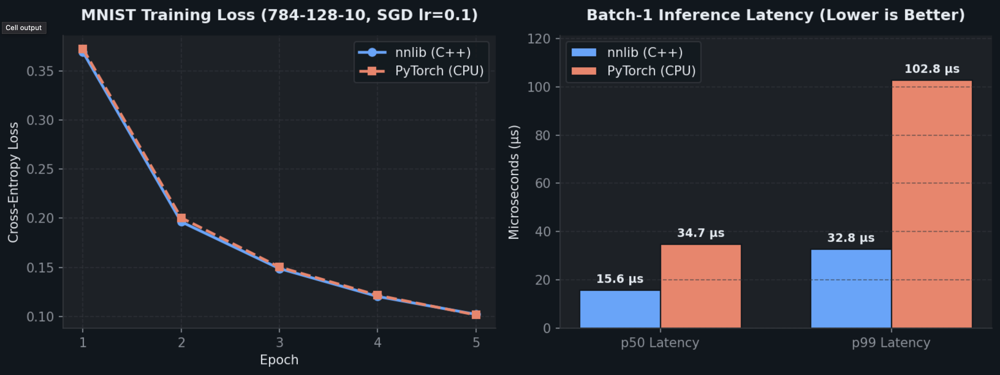

# NNLib

A small neural network library written from scratch in C++17. No dependencies, just the standard library.  
It is a learning project: build an MLP (multi-layer perceptron) by hand, understand every line, and measure it against PyTorch.

## What it has

- `Matrix` with add, sub, multiply, transpose, matmul (cache-blocked)
- Dense layers with forward and backward pass
- Activations: ReLU, sigmoid, tanh, none
- Initialization: He and Xavier
- Losses: MSE, softmax + cross-entropy
- Optimizers: SGD, Momentum, Adam
- `Network` class (a stack of layers), with binary save and load of weights
- MNIST loader, unit tests, and benchmark suite

Not included: convolutions, GPU, multi-threading, autograd. This is not a PyTorch replacement.

## Project structure

```text
nnlib/
├── include/nnlib/          # Header-only library
│   ├── nnlib.h             # Umbrella header (includes everything below)
│   ├── matrix.h            # Matrix class and operations
│   ├── init.h              # He / Xavier weight initialization
│   ├── layer.h             # Dense layer, activations
│   ├── loss.h              # MSE, softmax, cross-entropy
│   ├── optimizer.h         # SGD, Momentum, Adam
│   ├── network.h           # Stack of layers, save / load
│   └── data.h              # MNIST binary loader
├── examples/
│   ├── example_xor.cpp     # Tiny example: train XOR, save, load
│   └── train_mnist.cpp     # Train MLP on MNIST
├── tests/                  # Unit tests & finite-difference gradient checks
├── bench/                  # C++ vs. PyTorch speed & latency benchmarks
├── docs/math.md            # Derivations & backpropagation notes
└── CMakeLists.txt
```

## Quick start

Because `nnlib` is header-only, you can copy `include/nnlib/` into any C++17 project and include `<nnlib/nnlib.h>`:

```cpp
#include <nnlib/nnlib.h>

Network net(1);
net.add(784, 128, Act::ReLU);
net.add(128, 10, Act::None);
Optimizer opt(Opt::Adam, 0.001f);

// For each batch x (N x 784) with one-hot labels y (N x 10):
Matrix scores = net.forward(x);
Matrix grad = cross_entropy_grad(scores, y);
net.backward(grad);
net.step(opt);
```

## Build & run tests

Build all examples, benchmarks, and unit tests in Release mode (`-O3 -march=native`):

```sh
cmake -B build
cmake --build build -j
ctest --test-dir build --output-on-failure
```

Run the XOR example:

```sh
./build/example_xor
```

## Train on MNIST

Download the MNIST dataset into `data/`:

```sh
mkdir -p data && cd data
for f in train-images-idx3-ubyte train-labels-idx1-ubyte t10k-images-idx3-ubyte t10k-labels-idx1-ubyte; do
  curl -L -O https://github.com/golbin/TensorFlow-MNIST/raw/master/mnist/data/\(f.gz && gunzip -f\)f.gz
done
cd ..
```

Run training:

```sh
./build/train_mnist adam    # or: sgd, momentum
```

A `784-128-10` network reaches about **97% test accuracy** after 5 epochs.

## Benchmark against PyTorch

Same machine (Google Colab, Intel Xeon @ 2.2 GHz), 1 thread each, same network (`784-128-10`), SGD `lr=0.1`, batch size `64`.  
PyTorch 2.14.1 CPU, eager mode (plain Python, not LibTorch or `torch.compile`). Median of 5 epochs.



| Metric | nnlib | PyTorch |
|---|---|---|
| Training, time per epoch (median) | 1.44 s | **1.21 s** |
| Test accuracy after 5 epochs | 96.82% | **97.07%** |
| Single-image latency, p50 | **15.6 µs** | 34.7 µs |
| Single-image latency, p99 | **32.8 µs** | 102.8 µs |

- PyTorch trains ~1.2x faster on batch 64 because its BLAS matrix multiply is heavily tuned.
- `nnlib` answers a single image **2.2x faster at p50** and **3.1x faster at p99** because it has almost zero per-call framework overhead.
- Loss curves match across all 5 epochs (`0.1021` vs `0.1015`), confirming a fair comparison.
- Only eager-mode PyTorch was compared; compiled PyTorch setups would narrow the latency gap.
- Reproduce the benchmark with `bench/nnlib_vs_pytorch.ipynb`.


## Notes

- **Precision & determinism:** Uses `float32`. Passing the same seed produces identical weights for repeatable runs.
- **Gradient verification:** Analytical gradients in `backward()` are verified against numerical finite differences in `tests/`.
